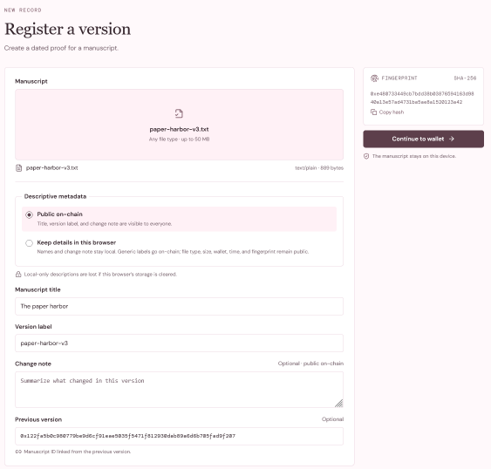
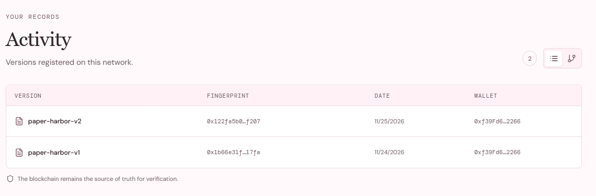
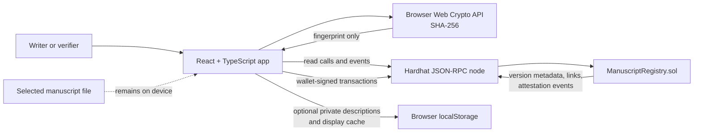

# InkChain

**A blockchain-backed provenance registry for manuscript versions.** InkChain fingerprints a file in the browser, then records that fingerprint and version metadata in a smart contract. A later copy can be checked by hashing it again and comparing the result with the registry.

> InkChain is an academic prototype designed for a local Hardhat network. It demonstrates integrity checks and linked version history; it is not a production publishing platform or an identity-verification service.

## At a glance

- **Files stay local.** The browser computes a SHA-256 fingerprint with the Web Crypto API. Manuscript contents are not uploaded to the contract or an InkChain server.
- **Versions are linked.** Each fingerprint identifies a version. A manuscript ID groups versions, and an optional parent fingerprint links a revision to its predecessor. A version can have multiple children.
- **Records are inspectable.** The app shows version metadata, wallet and transaction details, block information, parent/child links, and attestations.
- **Verification is a comparison.** InkChain hashes a selected file and searches the configured registry for that exact fingerprint.
- **Attestations are wallet declarations.** A signer can declare the Editor or Publisher role for a version. The contract records the wallet, role, and time; it does not verify the signer’s identity or authority.

## Screenshots

<table>
  <tr>
    <td align="center"><strong>Overview</strong><br></td>
    <td align="center"><strong>Register a version</strong><br></td>
    <td align="center"><strong>Activity</strong><br></td>
  </tr>
</table>

## Architecture



### Registration and verification

1. The user selects a file. The browser reads it locally and calculates its SHA-256 fingerprint; files over 50 MB are rejected by the interface.
2. For registration, the user enters version details and may provide a parent version fingerprint. An injected wallet or the local demo account signs the transaction.
3. `ManuscriptRegistry` stores the fingerprint-keyed record and emits a `VersionRegistered` event. The event and contract state are used to rebuild the activity list.
4. For verification, the browser hashes the selected file and checks for the exact fingerprint in the configured registry. A match identifies the corresponding registered record; it does not prove authorship.

### On-chain and local data

| Data | Where it lives | Notes |
| --- | --- | --- |
| Manuscript bytes and original filename | User’s device | Never uploaded by this prototype. |
| Version fingerprint (SHA-256), manuscript ID, parent ID | Blockchain | The fingerprint is the version ID; the manuscript ID groups versions. |
| Registering wallet, timestamp, file type, file size | Blockchain | Public in both metadata modes. |
| Title, version label, change note | Blockchain or browser storage | Public mode stores the entered values on-chain. Local-details mode stores generic labels on-chain and keeps the descriptions in that browser’s local storage. |
| Editor/Publisher attestation | Blockchain | Stores the signing wallet, declared role, and timestamp. |
| Activity cache and local descriptions | Browser `localStorage` | Convenience data only; the registry is the source of truth when connected. |

Local descriptions do not travel to another device and can be lost if browser storage is cleared. In either mode, the fingerprint, IDs, file type, file size, wallet, timestamp, and version links remain public. Do not put secrets in public metadata.

## Technology

- **Frontend:** React 18, TypeScript, Vite, and Lucide icons
- **Blockchain:** Solidity `^0.8.24`, Hardhat 2, and a local Hardhat JSON-RPC node
- **Ethereum client:** ethers.js v6
- **File fingerprinting:** browser Web Crypto API (`SHA-256`)
- **Contract tests:** Hardhat with Node’s built-in `node:assert/strict`

## Run the local demo

### Prerequisites

- Node.js 20 or newer and npm
- A modern browser
- MetaMask is optional for the local walkthrough; InkChain can use an unlocked account exposed by the local Hardhat node

### Start the app

Open the project directory in a terminal and install dependencies:

```bash
npm install
```

Start the local chain in **Terminal 1** and leave it running:

```bash
npm run chain
```

Deploy the registry in **Terminal 2**:

```bash
npm run deploy:local
```

The deployment script writes `.env.local` with the contract address, RPC URL, chain ID, and deployment block. If Vite is already running, stop and restart it after deploying so it reloads the new environment values.

Start the frontend:

```bash
npm run dev
```

Open the local URL printed by Vite. Use **Use demo account** for the local Hardhat account, or connect an injected wallet such as MetaMask configured for the local network:

| Setting | Value |
| --- | --- |
| RPC URL | `http://127.0.0.1:8545` |
| Chain ID | `31337` |
| Currency symbol | `ETH` |

Hardhat’s unlocked accounts and private keys are public test credentials. Use them only on the local development chain; never fund them or reuse them with real assets. The wallet-free demo signer is restricted to loopback RPC addresses.

### Demo walkthrough

The [`demo_files/`](demo_files/) folder contains fictional sample manuscripts and its own walkthrough.

1. Register `paper-harbor-v1.txt` as the first version.
2. In Activity, open its record and copy the fingerprint.
3. Register `paper-harbor-v2.txt`, using the copied fingerprint as its previous version.
4. Repeat with `paper-harbor-v3.txt` to create a three-version history.
5. Open **Verify a file**, select a registered file, and check for a match. Select `unregistered-story.txt` to demonstrate a non-match.
6. Open a version record to inspect its metadata and, optionally, add an Editor or Publisher attestation.

The local chain keeps state in memory. Restarting its node clears its records, so deploy the contract again and re-register the demo versions after a restart.

## Commands

| Command | Purpose |
| --- | --- |
| `npm run dev` | Start the Vite development server. |
| `npm run build` | Type-check the app and create a production build in `dist/`. |
| `npm run preview` | Serve the production build locally. |
| `npm run chain` | Start the local Hardhat JSON-RPC node on port `8545`. |
| `npm run deploy:local` | Compile and deploy `ManuscriptRegistry` to the running local node. |
| `npm run test:contract` | Run the smart-contract test suite. |

## Contract model

`ManuscriptRegistry` uses the file fingerprint as the key for each `Version` record. A record contains:

- manuscript ID and parent version fingerprint
- registering wallet and block timestamp
- file size and detected MIME type (or extension fallback)
- manuscript title, version label, and change note

The contract tracks children by parent fingerprint, so version histories can branch. It emits `VersionRegistered` and `VersionAttested` events, which the application reads to display history and activity. `getVersion`, `getChildren`, and `getAttestations` expose the stored record details.

Attestations are unique per version, wallet, and role. The same wallet may declare both roles, but it cannot submit the same role twice for one version. The contract records the declaration; it does not check real-world credentials.

## Tests

Run:

```bash
npm run test:contract
```

The suite deploys a fresh registry for each test and covers metadata storage, parent/child links, duplicate fingerprints, invalid or mismatched parents, required metadata, Editor/Publisher attestations, duplicate attestations, and attestations for unknown versions.

## Troubleshooting

### `EADDRINUSE` on `127.0.0.1:8545`

Another process is already using the local Hardhat port. If it is the existing Hardhat node, use it and continue to deployment. Otherwise stop the process using port `8545` before running `npm run chain`.

### `Cannot connect to the network localhost`

Start the Hardhat node first and leave it running while deploying. The deploy command connects to the node at `http://127.0.0.1:8545`.

### `could not decode result data` or “Registry offline”

The configured contract address may not contain the current registry contract, or the frontend may have stale deployment settings. Deploy to the currently running chain with `npm run deploy:local`, then restart the Vite server. A fresh Hardhat node also requires a fresh deployment.

### No wallet found

For the local demo, confirm the Hardhat node is running and that `.env.local` points to `http://127.0.0.1:8545`; then use **Use demo account**. For another network, install/connect an injected wallet and ensure it is on the same chain as the configured registry RPC.

## Project layout

```text
contracts/ManuscriptRegistry.sol  Solidity registry contract
contract-tests/                  Hardhat contract tests
scripts/deploy.ts                Local deployment and .env.local setup
src/App.tsx                      Application pages and UI state
src/chain.ts                     Wallet, provider, hashing, and contract helpers
src/styles.css                   Light and dark themes and layout styles
demo_files/                      Fictional sample manuscripts for walkthroughs
screenshots/                     README and report screenshots
```

## Team

| Member | GitHub |
| --- | --- |
| Sajal (project lead) | [@akasajal](https://github.com/akasajal) |
| Darshan | [@darshann0319](https://github.com/darshann0319) |
| Sangeeta | [@sangeeta006](https://github.com/sangeeta006) |
| Md. Zaid | [@mohd-zaidb](https://github.com/mohd-zaidb) |

## License and intellectual property

InkChain is proprietary software provided solely for academic evaluation, assessment, and demonstration. All rights are reserved by the project authors. No permission to copy, modify, redistribute, deploy, or commercially exploit InkChain is granted by this repository. See the [LICENSE](LICENSE) file for the full terms.

Third-party libraries and tools used by the project remain subject to their respective licenses and terms.
